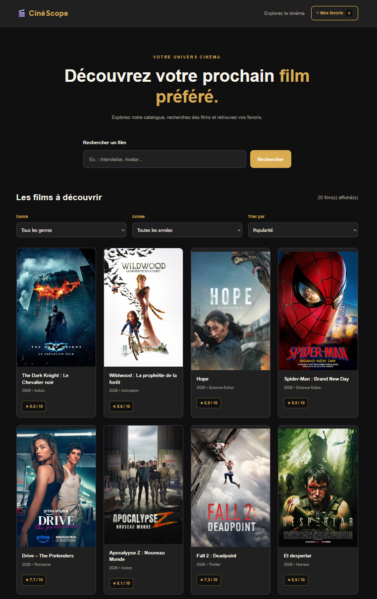

# 🎬 CinéScope

**CinéScope** est une application web de découverte de films développée en HTML, CSS et JavaScript.

Elle permet de parcourir un catalogue de films, de rechercher des titres, de filtrer les résultats et de créer une liste de favoris.

Ce projet a été réalisé dans le cadre de mon portfolio de développeur web.

## 📸 Aperçu du projet



## 🌐 Démonstration

🔗 **Site en ligne :** [Découvrir CinéScope](URL_DU_SITE)

## ✨ Fonctionnalités

- 🎥 Affichage dynamique des films depuis l'API TMDB
- 🔎 Recherche de films par titre
- 🎭 Filtrage par genre et par année
- ⭐ Tri par popularité, note et date de sortie
- 📄 Pagination des résultats
- 🎬 Fiches détaillées avec affiche, synopsis, durée et genres
- ❤️ Gestion des films favoris
- 💾 Sauvegarde des favoris dans le navigateur avec `localStorage`
- 📱 Interface responsive adaptée aux mobiles, tablettes et ordinateurs

## 🛠️ Technologies utilisées

- **HTML5** — Structure des pages
- **CSS3** — Mise en forme, animations et responsive design
- **JavaScript** — Interactions et gestion des données
- **API TMDB** — Informations sur les films
- **Cloudflare Workers** — Intermédiaire sécurisé pour les appels API
- **Git et GitHub** — Gestion du code source
- **GitHub Pages** — Hébergement du site

## 📁 Structure du projet

```text
Catalogue-films/
├── assets/
│   └── images/
│       └── films/
├── css/
│   └── style.css
├── js/
│   └── script.js
└── index.html
```

## 🚀 Utilisation

1. Ouvrir le site CinéScope.
2. Parcourir les films disponibles.
3. Utiliser la barre de recherche ou les filtres.
4. Cliquer sur un film pour consulter ses informations.
5. Ajouter ses films préférés aux favoris.

## 🔐 API et sécurité

Les données des films proviennent de **The Movie Database (TMDB)**.

Les requêtes passent par un Cloudflare Worker afin de conserver le token d'accès TMDB côté serveur, sans l'exposer dans le code JavaScript public.

## 🎯 Objectifs du projet

Ce projet m'a permis de mettre en pratique :

- La création d'une interface responsive
- La manipulation du DOM en JavaScript
- La consommation d'une API REST
- La gestion des événements utilisateur
- Le stockage local avec `localStorage`
- La gestion des requêtes asynchrones
- La publication d'un site web sur GitHub Pages

## 🤖 Utilisation de l'intelligence artificielle

Ce projet a été réalisé avec l'accompagnement de **ChatGPT (OpenAI)**, utilisé comme outil d'aide à l'apprentissage et au développement.

L'IA m'a notamment apporté une aide importante pour :

- **Cloudflare Workers** : comprendre le fonctionnement d'un proxy API, configurer le Worker et sécuriser l'accès à l'API TMDB.
- **JavaScript** : obtenir des explications, des exemples de code et de l'aide pour développer et corriger certaines fonctionnalités.

J'ai travaillé sur ce projet progressivement, en intégrant les différentes fonctionnalités, en effectuant les tests et en vérifiant le résultat dans le navigateur.

**L'objectif était avant tout d'apprendre, de comprendre les technologies utilisées et de progresser dans ma pratique du développement web.**

Ce projet reflète donc à la fois mon travail personnel, mon apprentissage et ma capacité à utiliser l'IA comme outil d'assistance technique.

## 📌 Statut

✅ Projet développé, testé et publié.

---

*Ce projet utilise les données de TMDB mais n'est ni approuvé ni certifié par TMDB.*
